# Nastro for Organelle

Nastro is an OP-1-inspired tape workstation for Organelle 1. It combines seven synth engines, a 24-part drum sampler, a four-track tape recorder, effects, four sequencer pages, project saving and a tape editor.

This manual describes the current generated source in `nastro-src`. Screen images are rendered with the project’s bundled OLED simulator at the real 128 × 64 pixel resolution; values in the images are examples.

## Quick map

Hold **AUX** and press a mode key:

| Key | Page | What it does |
| --- | --- | --- |
| C | SYNTH | Play and shape the selected synth engine. |
| C# | DRUM | Play, edit and sample drum slots. |
| D | TAPE | Four-track tape transport and looping. |
| D# | MIX | Tape levels/pan, delay and reverb. |
| E | SEQ | Tempo, step sequencer, Tombola and Endless sequencer. |
| A | SAVE | Save the open project from any page. |
| high A# / high B | OCTAVE | Transpose the keyboard down/up by octaves. |

Turn the encoder to open the **PROJECTS** menu. Turn it to select an item and press it to confirm. In the desktop simulator, comma and full stop turn the encoder; slash presses it.

## Synth

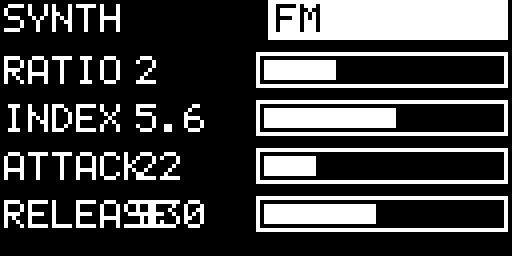

Enter SYNTH with **AUX + C**. Press **AUX + C** again to cycle the engines:

- **FM** — Ratio, Index, Attack, Release.
- **SUB** — sub/saw voice with filter and envelope controls.
- **PLUK** — Karplus-Strong string voice.
- **PAD** — detuned saw pad with a slow envelope.
- **SMPL** — playable recorded sample.
- **AIR** — resonant, breath-like noise voice: Attack, Release, Q and Movement.
- **GLASS** — four-partial bell voice: Decay, Brightness, Inharmonicity and Beating.

The four knobs control the parameters named on screen for the current engine. Hold AUX and use knob 1 for **SYNTH VOLUME**. The normal synth view shows the selected engine, octave and four parameter bars.

### Sample instrument

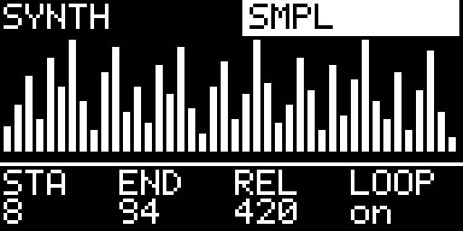

With the SMPL engine selected:

- **AUX + E5** arms recording from the stereo audio input. Recording starts when the input crosses the threshold; there is a 15 ms pre-roll.
- **AUX + F5** records Nastro’s master output immediately.
- Press the same record key again to stop; maximum time is 10 seconds.
- **AUX + F#5** toggles input monitoring. The monitored input goes through Nastro’s effects and can be recorded onto tape.
- **AUX + A** saves the sample as part of the project.

The four SMPL knobs set Start, End, Release and Loop. Start/end are aligned to an upward zero crossing to reduce clicks.

## Drum sampler

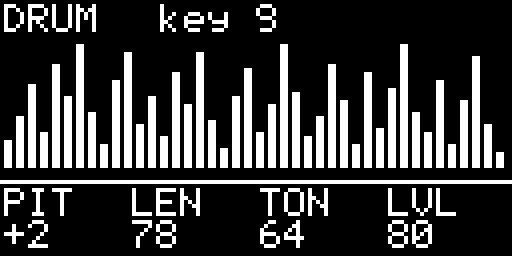

Enter DRUM with **AUX + C#**. The keyboard plays 24 slices from `drums.wav`; the most recently played key becomes the edited slot. Knobs are:

1. Pitch
2. Length
3. Tone
4. Level

Hold AUX and use knob 1 for **DRUM VOLUME**.

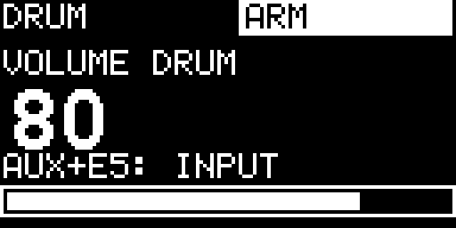

To sample into the selected drum key, use **AUX + E5** for audio input or **AUX + F5** for Nastro’s output. Input recording can be armed and starts at the threshold; output recording starts immediately. The OLED displays `ARM` or `REC` while this is active. The kit’s per-key settings are stored with the project.

## Tape

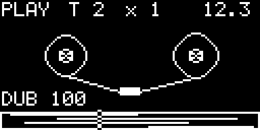

Enter TAPE with **AUX + D**. There are four mono tracks, each up to 60 seconds, mixed as a stereo bus with individual levels and pan.

| Control | Action |
| --- | --- |
| AUX + F | Play / stop. |
| AUX + F# (or footswitch) | Record / stop recording. Record automatically starts playback. |
| AUX + G | Rewind to the start. |
| AUX + G# | Loop: first press sets start, second sets end and enables looping, third disables loop. |
| AUX + C#5 / D#5 | Move backward / forward by the current navigation unit. |
| AUX + A | Save the project. |

Tape knobs:

1. **Speed** — seven octave steps from -2 to +2. With AUX held it is continuous and has detents at -1, 0 and +1. Recording is forced to 1× speed.
2. **Track** — selects tracks 1–4.
3. **Overdub** — 0 replaces the signal, 1 adds fully; intermediate positions blend old and new material.
4. **Wow** — tape-style pitch movement; it is disabled while recording.

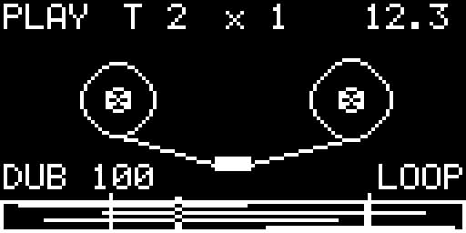

When looping is on, the loop region is shown in the tape view. Loop wraps use a short output crossfade to avoid clicks. In the TEMPO page, set loop quantisation to Free, Beat or Bar before defining a loop.

### Erasing and tape editing

To erase by recording, set Overdub to 0 and record silence over the desired part. For direct destructive editing, press the encoder while in TAPE.

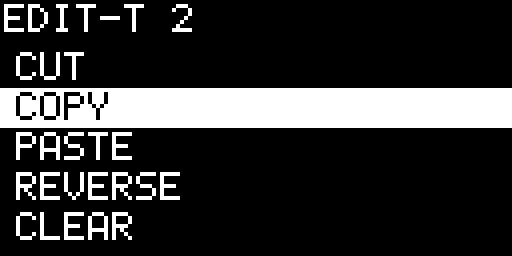

The editor works on the selected track and on the loop region (when looping) or the current bar:

- **CUT**, **COPY**, **PASTE**, **REVERSE**, **CLEAR**, **DUPLICATE**.
- **UNDO** swaps the previous version with the current one; press it again for redo.
- **MODE: 1 TRACK / ALL** chooses whether an edit runs on the selected track or all four tracks.
- **PROJECTS >** returns to the project list.

Recording or loading a project clears the tape editor undo memory. Copy/paste and duplicate are the supported way to move a loop between tape locations.

## Mix and effects

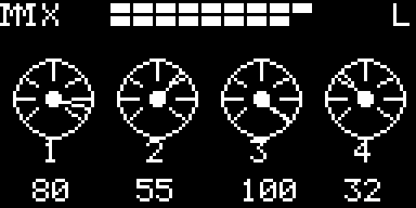

Enter MIX with **AUX + D#**. The default page has four OP-1-style dials, one per tape track. Knobs set each track’s **level**. The title row includes left/right output meters and a `LIM` indicator when the master limiter is working.

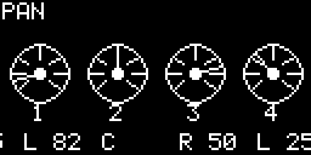

Hold AUX to show and edit **pan** instead of level. Centre keeps the track at full level on both stereo channels; moving away from centre balances it to the left or right.

Press **AUX + D#** again to reach the FX page.

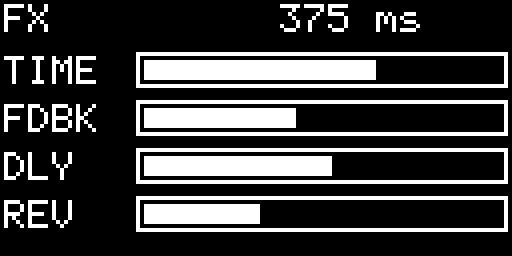

Without AUX, FX knobs control:

1. **TIME** — delay time; it can follow the delay-sync value in TEMPO.
2. **FDBK** — delay feedback.
3. **DLY** — delay amount.
4. **REV** — reverb amount.

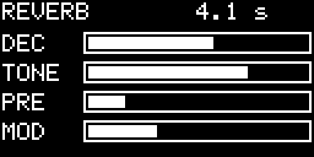

Hold AUX on the FX page for the reverb page:

1. **DEC** — reverb decay, approximately 0.4–12 seconds.
2. **TONE** — damping / brightness.
3. **PRE** — pre-delay, 0–120 ms.
4. **MOD** — modulation depth.

The master has a fast limiter with no added latency. The metronome and tape input are outside the limiter.

## Sequencers and tempo

Enter SEQ with **AUX + E**. Repeat **AUX + E** to cycle: **TEMPO → STEP → TOMBOLA → ENDLESS**.

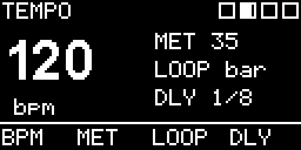

### Tempo

Knobs set:

1. BPM, 60–200.
2. Metronome level.
3. Tape-loop quantisation: Free, Beat or Bar.
4. Delay sync: Free, 1/16, 1/8, dotted 1/8, 1/4, dotted 1/4 or 1/2.

The metronome is output-only: it is not written onto tape.

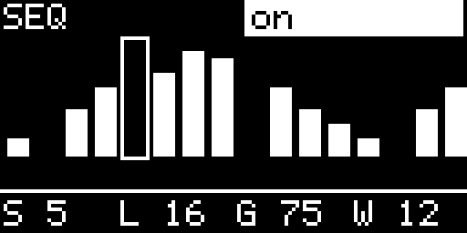

### Step sequencer

On the STEP page, a played key writes a note at the cursor, advances the cursor and enables the sequence. Controls:

- **AUX + A#** writes a rest.
- **AUX + B** clears the pattern.
- **AUX + C5** toggles playback.
- Knob 1: cursor; knob 2: sequence length (1–16); knob 3: gate; knob 4: swing.

The sequence is clocked from the tape clock and is saved with the project.

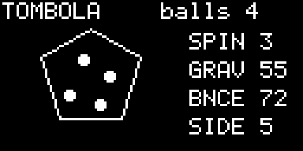

### Tombola

Tombola is a spinning polygon. Play a key to throw a note ball; a wall hit plays the note through the active instrument. Knobs set Spin, Gravity, Bounce and the number of polygon Sides (3–8).

- **AUX + A#** removes the latest ball.
- **AUX + B** removes all balls.
- **AUX + C5** pauses/resumes.

It runs only while its page is visible; balls remain stored when you leave it.

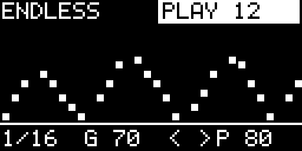

### Endless

While stopped, every played key appends a note (up to 64). **AUX + A#** appends a rest, **AUX + B** clears, and **AUX + C5** starts/stops. While running, a played key transposes the sequence relative to its first note.

Knobs set Rate (1/4–1/32), Gate, Direction (`>>`, `<<`, alternating or random) and Probability. Its notes and parameters are saved with the project.

## Projects and OLED mirror

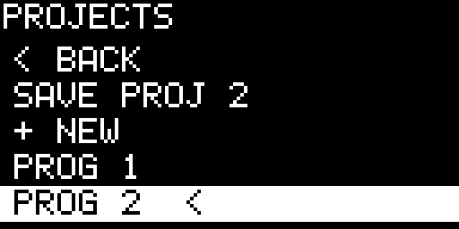

Turn the encoder to open PROJECTS. Available entries are:

- **BACK** — return to the previous page.
- **SAVE** — save the current project. If you are in the empty project (0), this creates the first unused project number.
- **+ NEW** — load a clean empty project.
- **PROG n** — load a saved project.
- **SCREEN TO MAC: OFF/ON** — start/stop OLED mirroring to a Mac.
- **SYSTEM (Organelle)** — return to the Organelle system menu.

Hold AUX and press the encoder on a project to remove it from the project list. Its files are deliberately left on disk. Loading or saving pauses playback, releases synth notes and fades the output briefly so tape WAV files can be handled safely.

To mirror the OLED on a computer, put the computer IP address in `mirror.txt` next to the patch, enable **SCREEN TO MAC**, then run `OLED_BIND=0.0.0.0 python3 oled-sim.py` on the computer and open `http://localhost:8123`. The simulator can also receive a `/snap` command to write a PNG.

## Practical limits

- Tape is four tracks × 60 seconds; projects save tape WAVs, synth/kit/sequencer settings and samples.
- Recording tape at speeds other than 1× is not implemented.
- Tape editor operations are destructive, but the last edit has undo/redo. Recorded audio itself cannot be undone.
- Nastro is designed for Organelle 1 / Pd 0.49. Avoid launching a second headless Pd instance on the device while the patch is running.
