# Nastro for Organelle

> **Disclaimer.** Nastro is an independent, non-commercial hobby project. The teenage engineering OP-1 was an inspiration for its workflow (a tape-centred workstation), but Nastro is not a copy or a clone of it: it contains no code, sounds, graphics or other material from the OP-1, and everything in it was written from scratch in Pure Data (the base drum kit is synthesized by a script, `nastro-src/makekit.py`). Nastro is not affiliated with, endorsed by or connected to teenage engineering. It is also an independent patch, not affiliated with Critter & Guitari. *OP-1* is a trademark of teenage engineering; *Organelle* is a trademark of Critter & Guitari. They are mentioned only to describe the inspiration and the hardware Nastro runs on.

Nastro is an OP-1-inspired tape workstation for Organelle 1. It combines eleven synth engines (FM, SUB, PLUK, PAD, SMPL, AIR, GLASS, WAVE, STRING, ORGAN, DRONE), a 24-part drum sampler, a four-track tape recorder (with 0.25× / 0.5× / 2× recording), a sampler with time-stretch, a synth LFO per engine, a mixer with per-track DJ filters and effect sends, delay, a reverb with freeze, a master compressor and limiter, four sequencer pages, project saving, a tape editor and an album recorder with a player.

This manual describes the current generated source in `nastro-src`. Screen images are rendered with the project’s bundled OLED simulator at the real 128 × 64 pixel resolution; values in the images are examples.

## Videos

See Nastro running on the Organelle:

- ▶ [Nastro demo 1 (Instagram)](https://www.instagram.com/p/Dfb0vVJAxTm/)
- ▶ [Nastro demo 2 (Instagram)](https://www.instagram.com/p/DfaXVU5gGDr/)

## Installation

**Requirements:** an Organelle 1 with Organelle OS 4.x (Pd 0.49). Nastro uses only Pd vanilla objects, no externals.

**Organelle M and S:** they run the same Organelle OS patch system (keys, knobs, AUX, encoder and OLED work the same way), so Nastro should work on them too, and their faster processors leave more headroom. It has only been tested on the Organelle 1, though: if you try it on an M or S, feedback is welcome.

**Download:** get the latest **Nastro-rel*.zip** from the [Releases page](https://github.com/becks/nastro/releases/latest) and unzip it: it contains the ready-to-copy `Nastro` folder (the `.pd` patches and `drums.wav`, the base drum kit). The same folder is also in this repository at `Nastro-Organelle/Patches/Nastro/`.

1. Copy the whole `Nastro` folder into the `Patches` folder of a USB stick (`Patches/Nastro/`), or into the `Patches` folder of the Organelle's SD card.
2. Plug the stick into the Organelle (or restart it) and choose **Nastro** in the patch menu.
3. Nastro starts with an empty project. Projects are saved next to the patch (`p1-…`, `p2-…`, `projects.txt`), so the folder must be writable: a USB stick works well.

When a USB stick with a `Patches` folder is plugged in, the Organelle lists the patches on the stick instead of those on the SD card.

**Updating:** copy the new `.pd` files over the old ones. Your projects and recordings (`p*-…` files, `projects.txt`) are not touched.

**Copying over the network (optional):** if the Organelle is on Wi-Fi, you can copy the folder from a computer with `scp -O -r Nastro root@<organelle-ip>:/usbdrive/Patches/`. The `-O` flag is needed with recent macOS versions.

**OLED mirror (optional):** to show the screen on a computer, create `mirror.txt` in the patch folder containing that computer's IP address followed by a semicolon, for example `192.168.1.114;`. See [Projects and OLED mirror](#projects-and-oled-mirror).

## Try it on a Mac

You can run Nastro on a computer with [Pure Data](https://puredata.info) (vanilla 0.51 or newer; developed with 0.54) and Python 3.

1. In Pd, open `Nastro/mac-sim.pd` only (it already contains Nastro: opening `main.pd` as well would run two copies). The simulator patch provides what the Organelle normally supplies: keys, knobs (sliders), AUX, encoder, audio input/output and the LED.
2. In a terminal: `cd Nastro && python3 oled-sim.py`, then open `http://localhost:8123` to see the 128 × 64 screen.
3. Click the `mac-sim.pd` window before playing, so it receives the keyboard.

| Computer key | Organelle |
| --- | --- |
| A W S E D F T G Y H U J K O L P | keys C … E |
| Space | AUX (hold) |
| `[` `]` | keys 82–83 (with Space: octave down / up) |
| `;` `'` | keys 76–77 (with Space: sample the input / Nastro's output) |
| `\` | key 78 (with Space: input monitor) |
| `,` `.` | turn the encoder |
| `/` | press the encoder |
| Z | footswitch |

## Building from source

The `.pd` files are generated by Python scripts in `nastro-src/`; edit the scripts, not the patches (see `nastro-src/README.md`).

```sh
cd nastro-src
python3 gen.py ../Nastro                 # regenerate all patches
python3 gensim.py ../Nastro              # regenerate the Mac simulator patch
# copy the result into the folder for the device
cd ../Nastro
for f in *.pd; do [ "$f" != mac-sim.pd ] && cp "$f" ../Nastro-Organelle/Patches/Nastro/; done
cp drums.wav ../Nastro-Organelle/Patches/Nastro/
```

The tests in `nastro-src/test_*.py` run Pd headless; they expect Pd at `/Applications/Pd-0.54-1.app` (if yours is elsewhere, change the path in the `subprocess.run` call of the test).

## Quick map

Hold **AUX** and press a mode key:

| Key | Page | What it does |
| --- | --- | --- |
| C | SYNTH | Play and shape the selected synth engine. |
| C# | DRUM | Play, edit and sample drum slots. |
| D | TAPE | Four-track tape transport and looping. |
| D# | MIX | Tape levels/pan, delay and reverb, track filters, master compressor, FX sends. |
| E | SEQ | Tempo, step sequencer, Tombola and Endless sequencer. |
| A | SAVE | Save the open project from any page. |
| high G | FREEZE | Freeze / release the reverb from any page (see Mix and effects). |
| high A | ALBUM | Record / stop an album (Nastro's output to a WAV file) from any page (see Album). |
| high A# / high B | OCTAVE | Transpose the keyboard down/up by octaves. |

On SYNTH, **AUX + high D** opens the engine's LFO page (see Synth LFO).

While anything records (tape, sampler, drum sampling or an album) the Organelle LED blinks.

Turn the encoder to open the **PROJECTS** menu. Turn it to select an item and press it to confirm. In the desktop simulator, comma and full stop turn the encoder; slash presses it.

## Synth

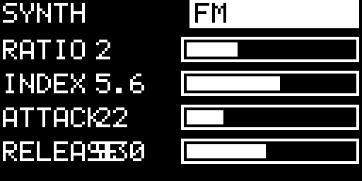

Enter SYNTH with **AUX + C**. Press **AUX + C** again to cycle the engines:

- **FM** — Ratio, Index, Attack, Release.
- **SUB** — two detuned saws through a resonant low-pass filter (Cutoff, Resonance, filter Envelope amount, Detune). Hold AUX for its **ADSR**: knob 2 Attack, knob 3 Decay (also used as Release), knob 4 Sustain; knob 1 stays the synth volume.
- **PLUK** — Karplus-Strong string voice.
- **PAD** — detuned saw pad with a slow envelope.
- **SMPL** — playable recorded sample.
- **AIR** — resonant, breath-like noise voice: Attack, Release, Q and Movement.
- **GLASS** — four-partial bell voice: Decay, Brightness, Inharmonicity and Beating.
- **WAVE** — wavefolder: Fold, Symmetry (adds even harmonics), Envelope (extra fold at the attack) and Release.
- **STRING** — plucked string with a body: Damping (bright ringing → muted), Body resonance, Pick position and Release.
- **ORGAN** — four drawbars (16', 8', 4', 2⅔', shown 0–8 like a real organ) with key click and a gentle leslie.
- **DRONE** — two slowly drifting, detuned saws through a breathing filter: Detune, Drift, Filter and Release (the attack is half the release).

The four knobs control the parameters named on screen for the current engine. Hold AUX and use knob 1 for **SYNTH VOLUME**.

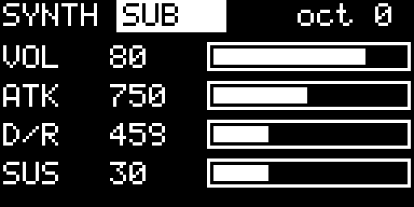

With SUB selected, the AUX page shows VOL, ATK, D/R and SUS (the filter envelope follows Attack and Decay, then closes, which keeps SUB's plucky character). The normal synth view shows the selected engine, octave and four parameter bars.

### Sample instrument

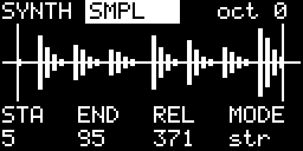

With the SMPL engine selected:

- **AUX + E5** arms recording from the stereo audio input. Recording starts when the input crosses the threshold; there is a 15 ms pre-roll.
- **AUX + F5** records Nastro’s master output immediately.
- Press the same record key again to stop; maximum time is 10 seconds.
- **AUX + F#5** toggles input monitoring. The monitored input is heard dry and can be recorded onto tape (once on a track it can go through the effects with the track’s sends).
- **AUX + A** saves the sample as part of the project.

The four SMPL knobs set Start, End, Release and **Mode**: `one` (plays once), `str` (time-stretch: every note lasts as long as the sample, whatever its pitch), `s+lp` (time-stretch and loop) and `loop`. Time-stretch is granular (50 ms grains): on very pure tones it can sound slightly detuned or chorused. Start/end are aligned to an upward zero crossing to reduce clicks.

### Synth LFO

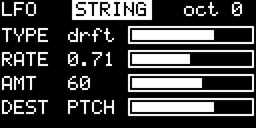

Every engine has its own LFO, saved with the project. On SYNTH, press **AUX + high D** to open the LFO page of the selected engine; press it again (or leave SYNTH) to go back to the parameters. The four knobs:

1. **TYPE** — `off`, `sine`, `tri`, `squ` (square), `ramp`, `rand` (a new random value each cycle), `drft` (smooth random drift), `trem` (vibrato and tremolo together; DEST is ignored), `env` (follows the level of the audio input: the synth breathes with another instrument).
2. **RATE** — 0.05 Hz (one cycle every 20 seconds) to 10 Hz.
3. **AMT** — depth, 0–100.
4. **DEST** — one of the engine's four parameters (shown with its name, e.g. `CUT`), `PTCH` (vibrato) or `VOL` (tremolo).

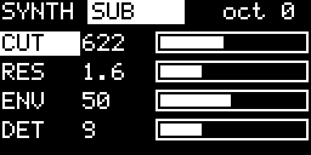

On a parameter the LFO moves the value around the knob position (at 100 % by half the knob range each way): turn the knob and the centre moves. The modulated parameter's label is shown inverted and its bar moves. `PTCH` is a vibrato of up to ±50 cents (less below about 0.5 Hz) that works on every engine; while it is active the synth sounds 12 ms later. The LFO only acts on the synth engines: drums and the input monitor are not affected.

## Drum sampler

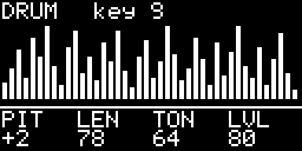

Enter DRUM with **AUX + C#**. The keyboard plays 24 slices from `drums.wav`; the most recently played key becomes the edited slot. Knobs are:

1. Pitch
2. Length
3. Tone
4. Level

Hold AUX and use knob 1 for **DRUM VOLUME**.

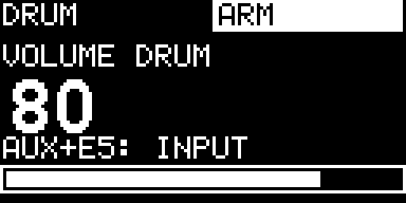

To sample into the selected drum key, use **AUX + E5** for audio input or **AUX + F5** for Nastro’s output. Input recording can be armed and starts at the threshold; output recording starts immediately. The OLED displays `ARM` or `REC` while this is active. The kit’s per-key settings are stored with the project.

## Tape

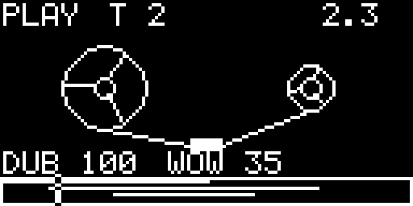

Enter TAPE with **AUX + D**. There are four mono tracks, each up to 60 seconds, mixed as a stereo bus with individual levels and pan.

| Control | Action |
| --- | --- |
| AUX + F | Play / stop. |
| AUX + F# (or footswitch) | Record / stop recording. Record automatically starts playback. |
| AUX + G | Rewind to the start. |
| AUX + G# | Loop: first press sets start, second sets end and enables looping, third disables loop. |
| AUX + C#5 / D#5 | Move backward / forward by the current navigation unit. |
| AUX + A | Save the project. |

Tape knobs:

1. **Speed** — nine steps: −2, −1, −0.5, −0.25, 0, 0.25, 0.5, 1, 2. With AUX held it is continuous and has detents at −1, 0 and +1. At **0.25×**, **0.5×** and **2×** the tape keeps its speed while recording (the classic tape trick): record at 0.5× and the new part plays an octave higher (and twice as fast) at 1×, at 0.25× two octaves higher; record at 2× and it plays an octave lower. At any other speed (continuous, 0 or reverse) recording runs at 1×.
2. **Track** — selects tracks 1–4.
3. **Overdub** — 0 replaces the signal, 1 adds fully; intermediate positions blend old and new material.
4. **Wow** — tape-style pitch movement; it is disabled while recording. The amount is shown on the bottom row as `WOW 0–100`, between `DUB` and `LOOP`.

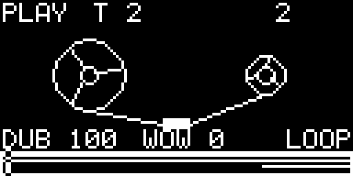

When looping is on, the loop region is shown in the tape view. Loop wraps use a short output crossfade to avoid clicks. In the TEMPO page, set loop quantisation to Free, Beat or Bar before defining a loop.

### Erasing and tape editing

To erase by recording, set Overdub to 0 and record silence over the desired part. For direct destructive editing, press the encoder while in TAPE.

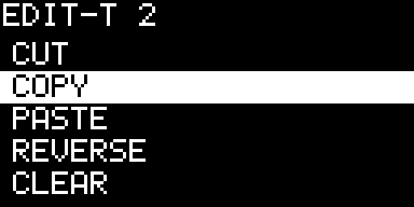

The editor works on the selected track and on the loop region (when looping) or the current bar:

- **CUT**, **COPY**, **PASTE**, **REVERSE**, **CLEAR**, **DUPLICATE**.
- **UNDO** swaps the previous version with the current one; press it again for redo.
- **MODE: 1 TRACK / ALL** chooses whether an edit runs on the selected track or all four tracks.
- **PROJECTS >** returns to the project list.

Recording or loading a project clears the tape editor undo memory. Copy/paste and duplicate are the supported way to move a loop between tape locations.

## Mix and effects

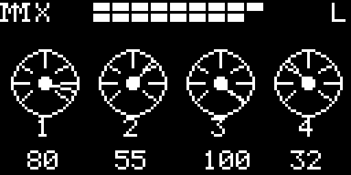

Enter MIX with **AUX + D#**. Pressing **AUX + D#** again cycles the pages: **MIX → FX → FILTER → MASTER → SEND** (then back to MIX). The default page has four round dials, one per tape track. Knobs set each track’s **level**. The title row includes left/right output meters and a `LIM` indicator when the master limiter is working.

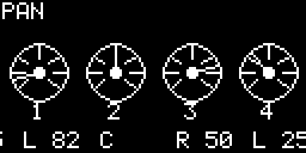

Hold AUX to show and edit **pan** instead of level. Centre keeps the track at full level on both stereo channels; moving away from centre balances it to the left or right.

Press **AUX + D#** again to reach the FX page.

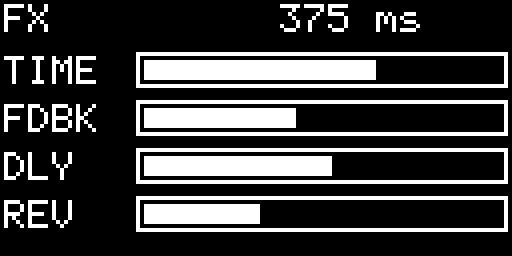

Without AUX, FX knobs control:

1. **TIME** — delay time; it can follow the delay-sync value in TEMPO.
2. **FDBK** — delay feedback.
3. **DLY** — delay amount (of the tape tracks, see SEND).
4. **REV** — reverb amount (of the tape tracks, see SEND).

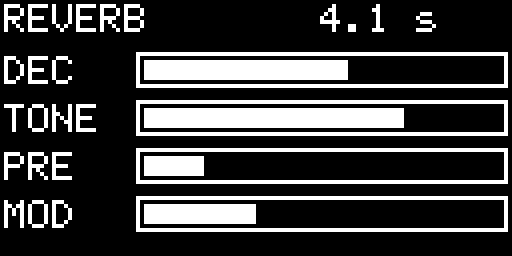

Hold AUX on the FX page for the reverb page:

1. **DEC** — reverb decay, approximately 0.4–12 seconds.
2. **TONE** — damping / brightness.
3. **PRE** — pre-delay, 0–120 ms.
4. **MOD** — modulation depth.

**Reverb freeze — AUX + G5** (from any page) freezes the reverb: what is ringing in it hangs as an endless pad, and new sound no longer enters the reverb until you release it. Press **AUX + G5** again to release: the tail fades out with the current DEC. While frozen the Organelle LED turns white and the FX and REVERB pages show `FRZ`; DEC and TONE changes made meanwhile are applied on release. Loading a project releases the freeze.

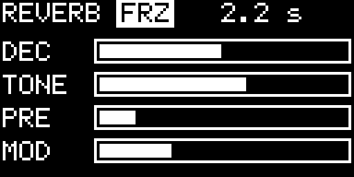

Press **AUX + D#** once more for the FILTER page.

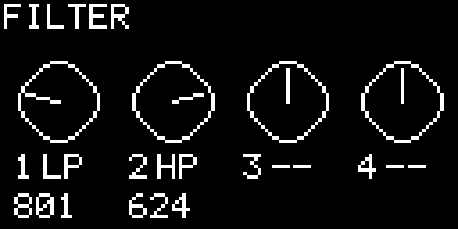

The FILTER page has a DJ-style filter for each tape track: knob 1–4 = track 1–4. The centre is off (a small dead zone makes it easy to find); turning left gives a low-pass filter (from 18 kHz down to 80 Hz), turning right a high-pass filter (from 20 Hz up to 8 kHz). Each dial shows `LP`, `HP` or `--` and the cutoff frequency in Hz. Hold AUX to set each track’s **resonance** (`Q`). Filters affect playback only, not what is recorded on the tape, and are saved with the project.

Press **AUX + D#** once more for the MASTER page.

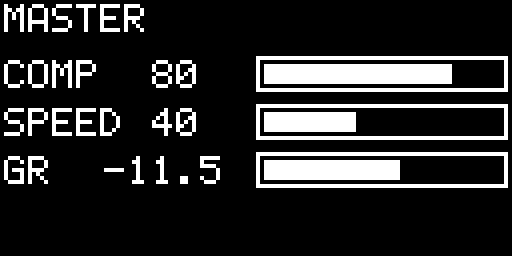

The MASTER page has a compressor on the whole output, before the limiter:

1. **COMP** — amount. At 0 it is off; turning it up lowers the threshold (down to −30 dB) and adds make-up gain automatically, so the mix gets denser and more even without getting quieter.
2. **SPEED** — from fast (5 ms attack, 50 ms release: audible pumping) to slow (50 ms / 800 ms: glue).

**GR** shows the current gain reduction in dB. The compressor settings are saved with the project.

The master has a fast limiter with no added latency. The metronome and tape input are outside the limiter.

Press **AUX + D#** once more for the SEND page (one more press goes back to the MIX page).

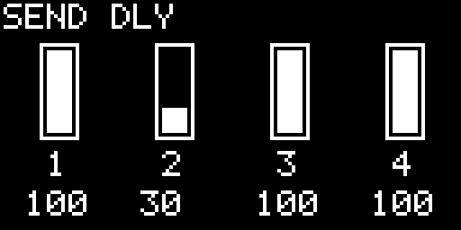

The SEND page sets how much of each tape track goes into the effects: knob 1–4 = delay send of track 1–4; hold AUX for the reverb send (the title turns to `SEND REV`). The sends are 0–100 and start at 100, so by default every track goes to the delay and reverb; turn a track down to keep it dry. **DLY** and **REV** on the FX page remain the overall amounts. Only tape tracks 1–4 reach the effects: the live synth, the drums and the input monitor are always dry (record them on a track to add effects). Sends are saved with the project.

## Sequencers and tempo

Enter SEQ with **AUX + E**. Repeat **AUX + E** to cycle: **TEMPO → STEP → TOMBOLA → ENDLESS**.

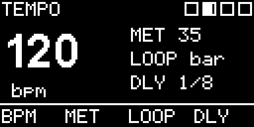

### Tempo

Knobs set:

1. BPM, 60–200.
2. Metronome level.
3. Tape-loop quantisation: Free, Beat or Bar.
4. Delay sync: Free, 1/16, 1/8, dotted 1/8, 1/4, dotted 1/4 or 1/2.

The metronome is output-only: it is not written onto tape.

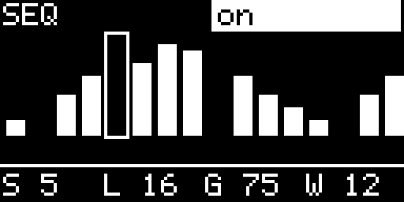

### Step sequencer

On the STEP page, a played key writes a note at the cursor, advances the cursor and enables the sequence. Controls:

- **AUX + A#** writes a rest.
- **AUX + B** clears the pattern.
- **AUX + C5** plays the sequence: with the tape stopped it starts the tape (the sequencer's clock); while the tape plays it switches the sequence on or off.
- Knob 1: cursor; knob 2: sequence length (1–16); knob 3: gate; knob 4: swing.

The sequence is clocked from the tape clock and is saved with the project.

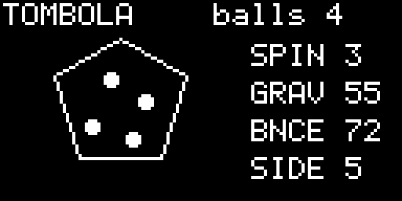

### Tombola

Tombola is a spinning polygon. Play a key to throw a note ball; a wall hit plays the note through the active instrument. Knobs set Spin, Gravity, Bounce and the number of polygon Sides (3–8).

- **AUX + A#** removes the latest ball.
- **AUX + B** removes all balls.
- **AUX + C5** pauses/resumes.

It runs only while its page is visible; balls remain stored when you leave it.

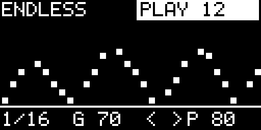

### Endless

While stopped, every played key appends a note (up to 64). **AUX + A#** appends a rest, **AUX + B** clears, and **AUX + C5** starts/stops. While running, a played key transposes the sequence relative to its first note.

Knobs set Rate (1/4–1/32), Gate, Direction (`>>`, `<<`, alternating or random) and Probability. Its notes and parameters are saved with the project.

## Album

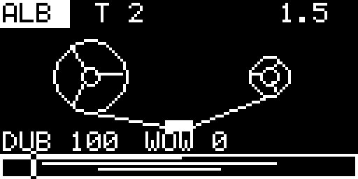

**AUX + high A** (from any page) records everything Nastro plays — tape, effects, live synth and drums, after the limiter — to a stereo 24-bit WAV file next to the patch on the USB stick: `album-1.wav`, `album-2.wav`, … If the tape is stopped it is rewound and started. Press **AUX + high A** again, or stop the tape with **AUX + F**, to close the file (the tape stops too). While an album records the LED blinks and the TAPE page shows `ALB` in place of `PLAY`. The file is streamed to disk while it records, so it does not use memory or cause glitches. The album numbering is kept in `album.txt`: if you delete that file, numbering starts again from 1 and overwrites `album-1.wav`.

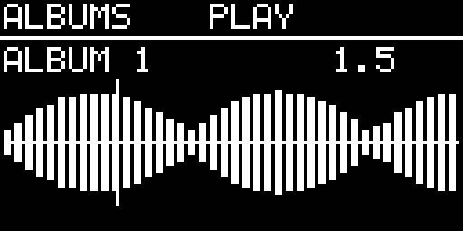

To listen to your albums, open the PROJECTS menu with the encoder and choose **ALBUMS >**. Turn the encoder to choose an album (newest first) and press it to play or stop. The page shows the album number, its length (the position while playing), its waveform and the playhead. **AUX + C#5 / D#5** jumps 5 seconds back / forward while playing. Playback reads the file straight from the stick and stops at the end, when you choose another album or when you leave the page. **< BACK** at the top of the list leaves the page. The waveform is saved while the album records (`album-N.txt`); albums recorded before this version play but show `?` and no waveform.

## Projects and OLED mirror

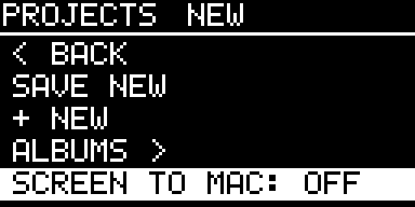

Turn the encoder to open PROJECTS. Available entries are:

- **BACK** — return to the previous page.
- **SAVE** — save the current project. If you are in the empty project (0), this creates the first unused project number.
- **+ NEW** — load a clean empty project.
- **PROG n** — load a saved project.
- **ALBUMS >** — listen to the recorded albums (see Album).
- **SCREEN TO MAC: OFF/ON** — start/stop OLED mirroring to a Mac.
- **SYSTEM (Organelle)** — return to the Organelle system menu.

Hold AUX and press the encoder on a project to remove it from the project list. Its files are deliberately left on disk. Loading or saving pauses playback, releases synth notes and fades the output briefly so tape WAV files can be handled safely.

To mirror the OLED on a computer, put the computer IP address in `mirror.txt` next to the patch, enable **SCREEN TO MAC**, then run `OLED_BIND=0.0.0.0 python3 oled-sim.py` on the computer and open `http://localhost:8123`. The simulator can also receive a `/snap` command to write a PNG.

## Practical limits

- Tape is four tracks × 60 seconds; projects save tape WAVs, synth/kit/sequencer settings and samples.
- Tape recording is possible at 0.25×, 0.5×, 1× and 2× only (not at continuous or reverse speeds).
- Tape editor operations are destructive, but the last edit has undo/redo. Recorded audio itself cannot be undone.
- Nastro is designed for Organelle 1 / Pd 0.49. Avoid launching a second headless Pd instance on the device while the patch is running.

## License

Copyright © 2026 becks.

Nastro is free software: you can redistribute it and/or modify it under the terms of the **GNU General Public License, version 3** (or, at your option, any later version), as published by the Free Software Foundation. It is distributed in the hope that it will be useful, but WITHOUT ANY WARRANTY; without even the implied warranty of MERCHANTABILITY or FITNESS FOR A PARTICULAR PURPOSE. See the [LICENSE](../LICENSE) file for the full text.

In short: you may use, study, share and change Nastro; if you distribute a modified version, it must stay under the GPL-3.0 and come with its source. This covers the patches, the generators in `nastro-src`, the base drum kit (`drums.wav`, generated by `makekit.py`) and this manual.
